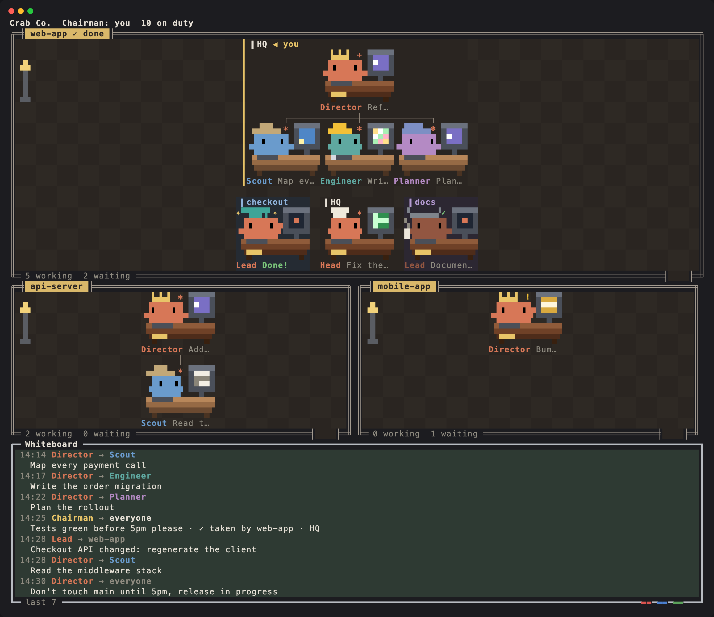
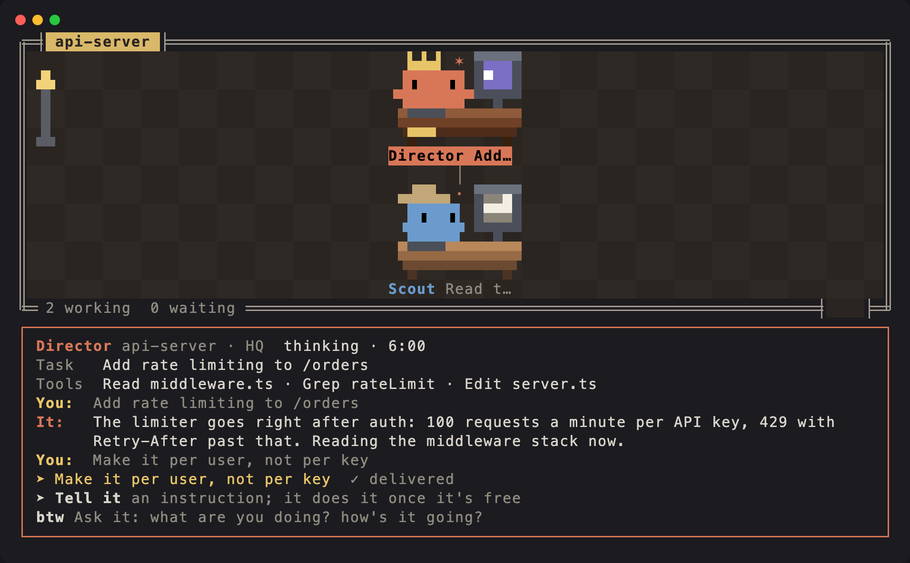

# 🦀 crab-office

Every Claude Code session running on your machine, and every subagent it hires, drawn as a pixel-art office.



- **Departments**: each repository gets a room, and each git worktree of it is a team inside that room.
- **Org charts**: a session is a team. Its manager is the session itself and its crew are its subagents, hung from one line. Each department has one crowned **Director**; every other manager wears a hat of their own.
- **Workstations**: every crab sits at a desk with a monitor that shows what it is doing: editing, running a command, reading, searching, thinking, waiting for your approval, resting, asleep, or gone home. Only working crabs have anything moving on their screen.
- **A shared whiteboard**: who handed what to whom, what came back, and what sessions said to each other, across every session.
- **You are the chairman**: post a memo to a team, a department or everyone, and an idle session picks it up.
- **Talk to any session**: click a manager for its card: what it is on, its recent conversation, and a field to give it an instruction, which it carries out once it is free. You keep the conversation going from the office without switching windows.
- **btw**: or just ask any crab what it is doing and how it is going. It answers on the side, without starting a turn or interrupting its work.
- **Colleagues**: every session gets an `office_board` tool, so the models can read the board and write to each other.



## Install

At the prompt of a terminal session:

```
/plugin install crab-office --marketplace BlueTriangleG/crab-office
```

Answer `y` to add the marketplace, then pick a scope (user is the usual one).

From a shell:

```
claude plugin install crab-office --marketplace BlueTriangleG/crab-office
```

In the desktop app, where `/plugin` does not run: click + next to the prompt box, then Plugins, Add marketplace with `BlueTriangleG/crab-office`, then Add plugin.

crab-office is a mod (a plugin of function hooks), so it needs a Claude Code build with mods. The office draws in the terminal; under `/tui fullscreen` the pane docks on the right.

## Language

The office speaks English by default. To switch to Chinese, set the plugin's `language` option to `zh` in `/config` (it is also offered when you install). Everything it shows you, and everything it tells the models, follows the setting.

## Use

| Command | What it does |
| --- | --- |
| `/office` | Open the office |
| `/office say message` | Pin a memo to the board for whoever is free first |
| `/office say @team message` | For one worktree team; `@<project>` for a department, `@everyone` for all. Typing `@` offers the names |
| `/office band` | Show or hide the strip of crabs above the prompt |
| `/office close` | Close the office |

In the pane:

- Click a crab for its card. A manager's card shows its last few exchanges, a **➤ Tell it** field for an instruction (it runs once that session is free, never interrupting it), and a **btw** field for a question it answers on the side. A crew member's card has the btw field.
- Click a line on the board to select the crab who said it and read the line whole. With more lines than fit, page with **▲ older** and **▼ newer** on the board's edges.
- Type in the field under the board and press Enter to pin a memo.
- A gold mark shows the team you are viewing from (◀ you).

## How it works

- Each session writes its state to `~/.claude/crab-office/live/<session id>.json` and heartbeats every 5 seconds. Other sessions read that folder to see who is in the company. A session silent for 30 seconds shows as gone home and leaves after 5 minutes.
- Memos live in `memos/` and claims in `claims/`, instructions in `orders/`; btw questions between sessions go through `asks/` and `replies/`. Everything is local files; nothing goes over the network.
- **What costs tokens**:
  - A memo is handed to an idle session as a new prompt. It goes only when that session's manager and crew have all finished, and you are not typing in its prompt box.
  - An instruction from a card is a new prompt in that session, run when its current turn ends.
  - Each btw question is one model call. Asking a manager forks its session's whole context (mostly served from the prompt cache).
- Only you can give instructions or post memos; a model has no way to. A message one session writes to another never wakes it. It waits until the reader next looks at the board, so two models cannot talk each other into turns without end.
- Background processes that the Claude Code daemon keeps warm stay out of the office until someone actually uses them.

The design choices, and the alternatives that were tried, are in [DESIGN.md](DESIGN.md).

## Develop

```
claude --plugin-dir ./           # load from this folder for one session
claude plugin validate .         # check the manifest, the hooks module and the marketplace file
claude plugin test .             # run the tests in tests/
```

`tsconfig.json` extends the types the engine writes to `.claude-plugin/types/` once the plugin has loaded; after that `tsc -p .` type-checks it.

## License

[MIT](LICENSE)
