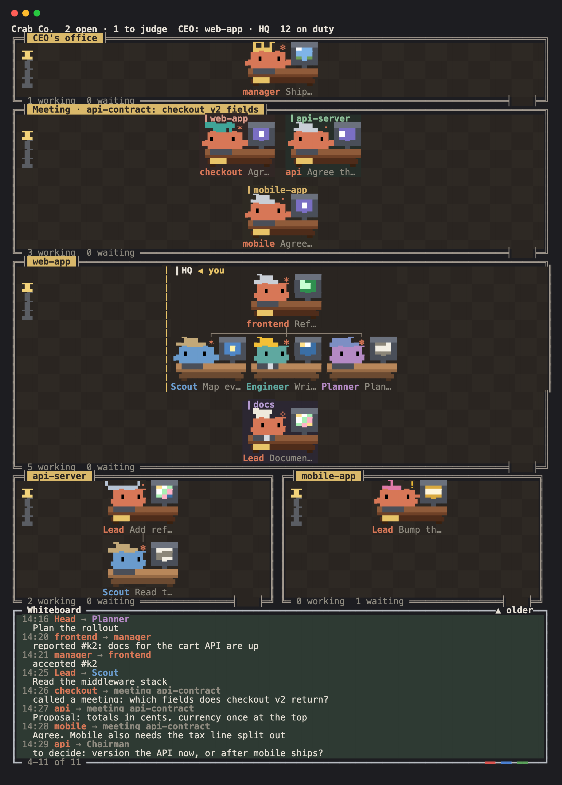
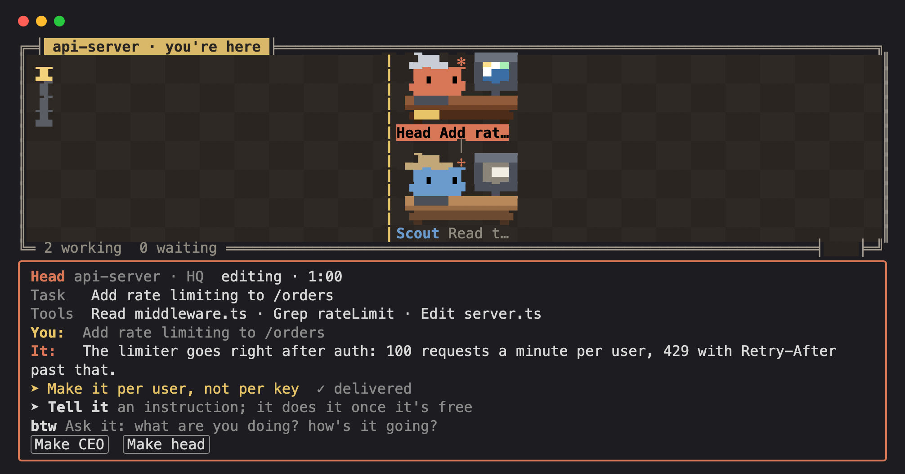

# 🦀 crab-office

Every Claude Code session running on your machine, and every subagent it hires, drawn as a pixel-art office.



- **Departments**: each repository gets a room, and each git worktree of it is a team inside that room.
- **Org charts**: a session is a team. Its manager is the session itself and its crew are its subagents, hung from one line. Each repository has a **Head** in a silver top hat (its longest-serving session, unless one is appointed); every other manager wears a hat of their own.
- **Workstations**: every crab sits at a desk with a monitor that shows what it is doing: editing, running a command, reading, searching, thinking, waiting for your approval, resting, asleep, or gone home. Only working crabs have anything moving on their screen.
- **A shared whiteboard**: who handed what to whom, what came back, and what sessions said to each other, across every session.
- **You are the chairman**: post a memo to a team, a department or everyone, and an idle session picks it up.
- **Talk to any session**: click a manager for its card: what it is on, its recent conversation, and a field to give it an instruction, which it carries out once it is free. You keep the conversation going from the office without switching windows.
- **btw**: or just ask any crab what it is doing and how it is going. It answers on the side, without starting a turn or interrupting its work.
- **A CEO you appoint**, modelled on DeepSeek's super-agent design ([below](#the-ceo-a-super-agent-built-from-claude-code)): make any session CEO from its card, and it wears the crown in an office of its own at the top. Hand it work and it gives each job to the session best placed, with how it will be judged; it can add to a job while it is being done, judges what comes back, and answers you. A watchdog nudges it when work stalls, and it keeps every line of work on a **tracker** under its office: each line still being worked, its status (stuck, at risk, on track), owner and where it stands in one line, kept in files rather than in its context. A line waiting on you goes onto your list instead, and a line done leaves the tracker. The CEO is the last check, not a go-between.
- **Colleagues**: sessions talk one to one with Claude Code's own SendMessage, and the board shows it with a ✉ by both crabs. Every session is told to go straight to the colleague who knows, and may have one review its work before handing it back. Give a session a one-word **job title** and a SendMessage to that title, or to `CEO`, reaches it, whatever name it goes by after a restart.
- **Meetings**: when three or more sessions must agree, any of them calls a meeting. Its members leave their desks for a meeting room, a SendMessage to the meeting's name reaches everyone at the table, and whoever called it closes it with the conclusion. A meeting quiet for 15 minutes ends by itself, and after 30 messages it passes on no more.
- **Waiting on you**: what only you can decide (an approval, a choice between plans), any session puts on your list, just above the board: who is waiting, and on what, and that crab has a **?** by its head. Answer each right there, and the answer goes to the session that asked as your own words; ✓ takes one off unanswered. It stays there, through compactions, until it is settled.
- **The board tool**: every session gets an `office_board` tool to read the board, write to a whole department, everyone or you without interrupting anyone, call and close meetings, and, under a CEO, run the work.



## The CEO: a super-agent built from Claude Code

The CEO is a practice run of the super-agent idea in the DeepSeek Harness team's write-up *Super-agent 设计探索：迈向更自主的 Agent 系统* ("Super-agent design exploration: towards more autonomous agent systems", 31 October 2026, on DeepSeek's official WeChat account), built only from what Claude Code already has: its sessions, its SendMessage between sessions, and plugin hooks.

| The super-agent design | In crab-office |
| --- | --- |
| Agents work one session at a time, and a person running several keeps every context in their head | The office shows every session at once, and you hand work to one CEO instead of picking a session yourself |
| A router faces the person; workers do the work in sessions of their own, and their results come back to the router | The CEO is the router: it gives each job to the session best placed, takes the report back, judges it and answers you |
| Event-driven, filtered twice: rules first, then the model decides whether to step in | A watchdog in code checks open jobs every 30 seconds (not started, waiting for approval, gone, too long, unjudged); only what it flags is put to the CEO's model, which decides what to do |
| An external watchdog, outside the agent, that spots work going nowhere | The watchdog is plugin code, not part of the CEO's conversation, so a CEO that compacted its context or lost track of a job is still nudged |
| Open questions: how a person sees progress, and which actions need a person's approval | You see progress in the office itself; what only you can decide waits on your list; and every message between sessions goes through Claude Code's own channel, so each session's permission mode still holds |

Where it goes its own way: it is flatter. Sessions do not route through the CEO; they ask each other directly, have a colleague review their work, and meet when three or more must agree. The CEO is the last check, not a go-between. Everything is local files on one machine, with no server.

## Install

At the prompt of a terminal session:

```
/plugin install crab-office --marketplace BlueTriangleG/crab-office
```

Answer `y` to add the marketplace, then pick a scope (user is the usual one).

From a shell:

```
claude plugin install crab-office --marketplace BlueTriangleG/crab-office
```

In the desktop app, where `/plugin` does not run: click + next to the prompt box, then Plugins, Add marketplace with `BlueTriangleG/crab-office`, then Add plugin.

crab-office is a mod (a plugin of function hooks), so it needs a Claude Code build with mods. The office draws in the terminal; under `/tui fullscreen` the pane docks on the right.

## Observe mode

Set the plugin's `mode` option to `observe` and the office only shows sessions: it hands them no memo, instruction, job or meeting, and gives their models no tool and no prompt. Every session run with `-p` or the SDK only observes by itself, so the office can be installed everywhere to watch a crowd of short-lived helpers without spending a turn of theirs. A btw still works on an observed session: it is you asking, answered on the side.

## Language

The office speaks English by default. To switch to Chinese, set the plugin's `language` option to `zh` in `/config` (it is also offered when you install). Everything it shows you, and everything it tells the models, follows the setting.

## Use

| Command | What it does |
| --- | --- |
| `/office` | Open the office |
| `/office say message` | Pin a memo to the board for whoever is free first |
| `/office say @team message` | For one worktree team; `@<project>` for a department, `@everyone` for all. Typing `@` offers the names |
| `/office text` | The office as text: every session with its marks, what waits on you with ids, the board's latest lines |
| `/office answer #id answer` | Answer an item waiting on you; `/office settle #id` takes one off unanswered |
| `/office tell @who instruction` | What a card's **➤ Tell it** does: it runs once that session is free. `@who` is a job title, SendMessage name or team |
| `/office btw @who question` | Ask a session on the side; the answer shows on its card |
| `/office card @who` | A session's card as text: task, recent talk, each instruction delivered or waiting, btw answers |
| `/office ceo @who` | Make a session CEO; `/office ceo off` to have none |
| `/office head @who` | Make a session its repository's head; `/office head off` to go back to the longest-serving |
| `/office band` | Show or hide the strip of crabs above the prompt |
| `/office close` | Close the office |

In the pane:

- Click a crab for its card. A manager's card shows its last few exchanges, a **➤ Tell it** field for an instruction (it runs once that session is free, never interrupting it), a **btw** field for a question it answers on the side, and buttons to make it CEO or its repository's head. A crew member's card has the btw field.
- Click a line on the board to select the crab who said it and read the line whole. With more lines than fit, page with **▲ older** and **▼ newer** on the board's edges.
- Type in the field under the board and press Enter to pin a memo.
- A gold mark shows the team you are viewing from (◀ you).
- Between the rooms and the board, **Waiting on you** lists what sessions need you to decide; a crab with a **?** by its head is one of them. Type an answer under an item and press Enter: it reaches the session that asked as your own instruction, run once that session is free, and the item comes off. ✓ takes one off without answering.

## How it works

- Each session writes its state to `~/.claude/crab-office/live/<session id>.json` and heartbeats every 5 seconds. Other sessions read that folder to see who is in the company. A session silent for 30 seconds shows as gone home and leaves after 5 minutes.
- Memos live in `memos/` and claims in `claims/`, instructions in `orders/`; btw questions between sessions go through `asks/` and `replies/`. Appointments are in `org/`, job titles in `titles/`, duties in `duties/`; a job is `jobs/`, `amends/`, `reports/` and `verdicts/`; meetings are in `meetings/`, and what waits on you in `decisions/` and `settled/`. Every file has one writer, the session it belongs to. Everything is local files; nothing goes over the network.
- **What costs tokens**:
  - A memo is handed to an idle session as a new prompt. It goes only when that session's manager and crew have all finished, and you are not typing in its prompt box.
  - An instruction from a card is a new prompt in that session, run when its current turn ends.
  - Each btw question is one model call. Asking a manager forks its session's whole context (mostly served from the prompt cache).
  - A job from the CEO, an addition to it, a report back, and each word in a meeting reach the other session at once and start a turn there if it is idle. The watchdog's nudges are prompts to the CEO, each at most once in 30 minutes.
- Only you appoint the CEO, post memos and give instructions from a card. A post on the board never wakes its reader: it waits until the reader next looks. A meeting's words do wake, so code, not the models, ends a meeting gone quiet and caps it at 30 messages. Everything one session sends another goes through Claude Code's own cross-session messages, so a session in another permission mode holds it for its own approval.
- Background processes that the Claude Code daemon keeps warm stay out of the office until someone actually uses them.

The design choices, and the alternatives that were tried, are in [DESIGN.md](DESIGN.md).

## Develop

```
claude --plugin-dir ./           # load from this folder for one session
claude plugin validate .         # check the manifest, the hooks module and the marketplace file
claude plugin test .             # run the tests in tests/
```

`tsconfig.json` extends the types the engine writes to `.claude-plugin/types/` once the plugin has loaded; after that `tsc -p .` type-checks it.

## License

[MIT](LICENSE)
