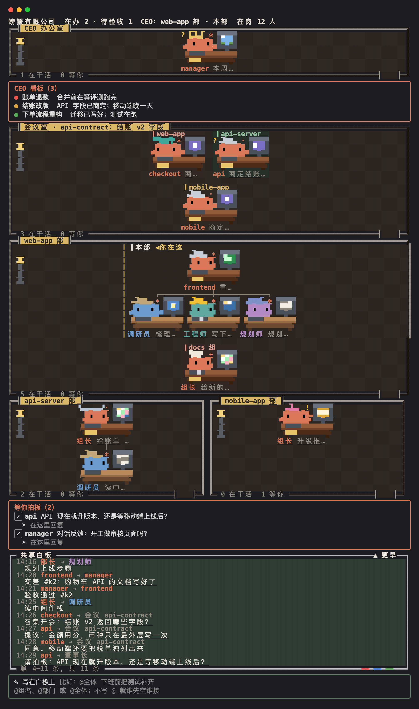
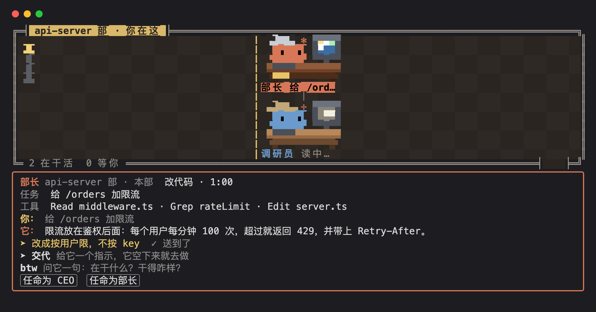
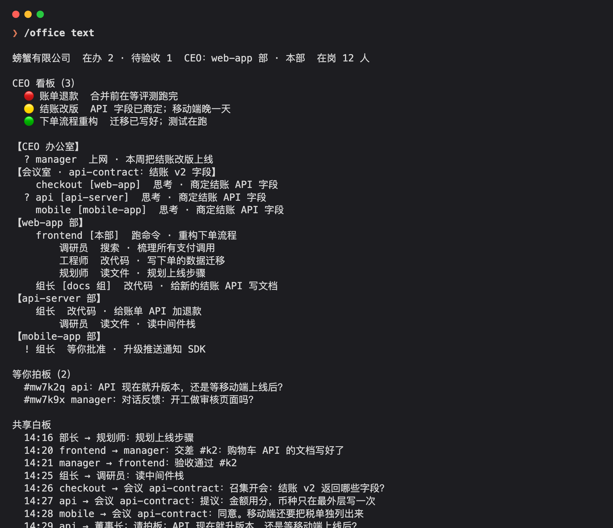

# 🦀 crab-office

[English](README.md) | **简体中文**

把你机器上正在运行的每个 Claude Code 会话，以及它们派出去的每个子代理，画成一间像素风的办公室。



- **部门**：每个代码仓库是一个房间，它的每个 git worktree 是房间里的一个组。
- **组织架构**：一个会话就是一个组。组长是会话本身，组员是它派出的子代理，挂在同一根线上。每个仓库有一位**部长**，戴银色礼帽（默认是在岗最久的会话，也可以任命）；其他组长各戴各的帽子。
- **工位**：每只螃蟹坐在一张带显示器的桌子前，显示器显示它正在干什么：改代码、跑命令、读文件、搜索、思考、等你批准、休息、打盹，或者已经下班。只有在干活的螃蟹屏幕上有动静。
- **共享白板**：谁把什么交给了谁、交回了什么、会话之间说了什么，所有会话的往来都在这里。
- **你是董事长**：给一个组、一个部门或全体贴一张留言，空闲的会话会接过去做。
- **和任何会话说话**：点一个组长，打开它的卡片：它在做什么、最近的对话，还有一个交代框，你写的指示它空下来就去做。不用切窗口，在办公室里就能接着聊。
- **btw**：也可以顺手问任何一只螃蟹在干什么、干得怎么样。它在旁边回答，不开新的一轮，也不打断手上的活。
- **你任命的 CEO**，参照 DeepSeek 的 super-agent 设计（[见下文](#ceo用-claude-code-搭的-super-agent)）：在卡片上把任何会话任命为 CEO，它会戴上王冠，坐进最上面单独的办公室。你把活交给它，它会派给最合适的会话，并写明怎么验收；活在做的时候可以补充要求，交回来由它验收，再统一回复你。活卡住了，督促程序会提醒它。CEO 是最后一道关，不是传话的。
- **CEO 看板**：在 CEO 办公室下面，列出正在做的每一项产品需求，标题用你会说的话；一个彩色圆点表示状态（绿色正常、黄色有风险、红色卡住），再加一句话说明做到哪了。CEO 把它记在文件里，不记在自己的上下文里，所以上下文压缩了也丢不了。等你定的事放到你的确认板上，做完的从看板上拿掉。
- **同事之间**：会话之间用 Claude Code 自带的 SendMessage 一对一说话，白板上能看到，两只螃蟹旁边都会出现 ✉。每个会话都被告知：有问题直接找懂行的同事，交差前可以请同事复核。给会话取一个一个词的**职位名**，用 SendMessage 发给这个职位名或 `CEO` 就能找到它，它重启后换了名字也一样。
- **开会**：三个或更多会话要商量定一件事时，任何一个都可以召集开会。与会者离开工位进会议室，发给会议名的 SendMessage 会送到在座的每个人，召集人写结论散会。15 分钟没人说话会自动散会，说满 30 条后不再转发。
- **等你拍板**：只有你能定的事（批准、在几个方案里选一个），任何会话都可以挂到你的确认板上，就在白板上面：谁在等、等你定什么，那只螃蟹头上会带一个 **?**。直接在那里回复，答复会作为你本人的话送到提问的会话；点 ✓ 则不回复直接划掉。在被处理之前它一直挂着，上下文压缩了也不会丢。
- **主题**：切换办公室说话的风格。主题会换掉对你和各级的称呼、办公室里的叫法，并给螃蟹们定一种互相说话、跟你说话的语气（自带一个「字节」：同事叫"同学"，开会叫"组会"，白板叫"大群"，派活叫"派需求"，称呼你「X总」，X 由 CEO 来问你）；汇报内容照常平实，代码、提交、PR 和文档一律不用这种语气。现在这一套就是默认主题；每个主题是一个文件夹（[`themes/`](themes/)），你自己的放在 `~/.claude/crab-office/themes/`。
- **herdr**：会话跑在 [herdr](https://herdr.dev) 里时，每个标签用它的职位名；需要你本人到场的会话会在标签上打 ⏳ 并弹通知；插件自带的 `herdr-sessions` skill 让 CEO 列出全部会话、让空闲的会话歇着、再把它们叫回来接着原来的对话（[见下文](#herdr)）。
- **终端模式**：窗格打不开、或者鼠标点不准的时候，`/office text` 把整个办公室打印成文字，`/office card @谁` 打印一个会话的卡片，`/office answer #编号` 回复等你拍板的事。
- **观察模式**：可以放心全局安装，让它只看不发：[观察模式](#观察模式)只显示会话，什么也不发给它们；每个 `-p` 运行或 SDK 会话自动只观察。
- **白板工具**：每个会话都有一个 `office_board` 工具，用来读白板、给整个部门、全体或你写留言（不打断任何人）、召集和结束会议，有 CEO 时还用来派活和管事。



## CEO：用 Claude Code 搭的 super-agent

CEO 是一次实践：把 DeepSeek Harness 团队的文章《Super-agent 设计探索：迈向更自主的 Agent 系统》（2026 年 10 月 31 日，发在 DeepSeek 官方公众号）里的 super-agent 思路，只用 Claude Code 现成的东西搭出来：它的会话、会话之间的 SendMessage，以及插件钩子。

| super-agent 的设计 | crab-office 的做法 |
| --- | --- |
| Agent 一次只在一个会话里干活，人同时推进好几件事时，要把每个上下文都记在脑子里 | 办公室一眼能看到所有会话；你把活交给一个 CEO，不用自己挑会话 |
| 上层一个 Router 统一对外，下层 Worker 在各自的会话里干活，结果汇回 Router | CEO 就是 Router：把每件活派给最合适的会话，收交差、验收，再回复你 |
| 事件驱动，两级过滤：先用程序规则筛，再由模型判断要不要介入 | 督促代码每 30 秒检查一遍在办的活（没开工、等批准、人不在了、做太久、没验收）；只有它标出的问题才交给 CEO 的模型去判断怎么办 |
| 一个在 agent 之外的 Watchdog，发现空转的工作 | 督促程序是插件代码，不在 CEO 的对话里，所以 CEO 压缩了上下文、或者忘了某件活，照样会被提醒 |
| 文章留下的问题：人怎么看进度，哪些操作要人批准 | 进度在办公室里直接看；只有你能定的事挂在你的确认板上；会话之间的每条消息都走 Claude Code 自己的通道，所以每个会话的权限设置照常生效 |

和文章不同的地方：它更扁平。会话之间不经过 CEO，直接互相问、请同事复核，三方以上要商量就开会。CEO 是最后一道关，不是传话的。一切都是一台机器上的本地文件，不需要服务器。

## 安装

在终端会话的输入框里：

```
/plugin install crab-office --marketplace BlueTriangleG/crab-office
```

提示添加 marketplace 时回答 `y`，再选一个范围（一般选 user）。

在 shell 里：

```
claude plugin install crab-office --marketplace BlueTriangleG/crab-office
```

桌面版不能用 `/plugin`：点输入框旁边的 +，选 Plugins，用 `BlueTriangleG/crab-office` 添加 marketplace，再添加插件。

crab-office 是一个 mod（由函数钩子组成的插件），需要支持 mod 的 Claude Code 版本。办公室画在终端里；在 `/tui fullscreen` 下，窗格停靠在右边。

## 主题

主题会换掉办公室对你、对各级的称呼和办公室里的叫法，也会换掉螃蟹们互相说话、跟你说话的语气。只改称呼和语气：汇报内容照常平实，代码、提交、PR 和文档一律不用。现在这一套就是默认主题；用 `/office theme <名字>` 切换。

每个主题是 [`themes/`](themes/) 里的一个文件夹，各有自己的 README：

- [**字节**](themes/bytedance/README.md)：办公室切成中文，按字节跳动同学的方式说话；称呼你"X总"，X 由 CEO 来问你。

你自己的主题放在 `~/.claude/crab-office/themes/<名字>/`（[一个主题文件夹里放什么](themes/README.md)）。因为是文件夹，以后主题还可以带上螃蟹的样子和动画。

## herdr

会话跑在 [herdr](https://herdr.dev) 里时（`HERDR_ENV=1`），办公室会配合它：

- 每个会话的标签用它的职位名，职位名一改，标签跟着改。
- 会话需要你本人到场时（被权限拦住、只认你亲口确认的操作），调用 `office_board confirm`。这件事挂到你的清单上，它的标签变成 `⏳ <职位名> · 等你确认`，herdr 弹一条带提示音的通知。你在那个会话里随便输入一句，就清掉了。
- 派给 herdr 里会话的活，会提示它用 `herdr worktree create` 单独开一个工作区，交差后收掉。
- 插件自带的 `herdr-sessions` skill 让 CEO 在 herdr 里管会话：列出每个会话的职位名和 session id；让空闲的会话歇着（要一份交接、记进 `~/.claude/crab-office/resting/` 的名册、关掉标签）；之后再把它叫回来，还是同一段对话，原来的工作区没了就新开一个。

herdr 只让它自己的 Claude 集成设置 Claude 标签的状态，所以靠标签名来提示。在 herdr 0.9.5 上实测过。不在 herdr 里，这些都不会发生。

## 观察模式

把插件的 `mode` 设置改成 `observe`，办公室就只显示会话：不给它们发留言、交代、派活或会议，也不给它们的模型任何工具或提示。每个用 `-p` 或 SDK 运行的会话自动只观察，所以可以到处安装，用来看一大群短命的帮手，不占用它们任何一轮。对被观察的会话照样可以问 btw：那是你主动在问，它在旁边回答。

## 语言

办公室默认说英文。要换成中文，在 `/config` 里把插件的 `language` 设置改成 `zh`（安装时也会问）。它给你看的一切、告诉模型的一切，都跟着这个设置走。

## 使用

| 命令 | 作用 |
| --- | --- |
| `/office` | 打开办公室 |
| `/office say 留言` | 在白板上贴一张留言，谁先空谁接 |
| `/office say @组名 留言` | 只给一个 worktree 组；`@<项目名>` 给一个部门，`@全体` 给所有人。输入 `@` 会提示名字 |
| `/office text` | 文字版办公室：每个会话和它的标记、等你拍板的事和编号、白板最近几条 |
| `/office answer #编号 答复` | 回复一件等你拍板的事；`/office settle #编号` 不回复直接划掉 |
| `/office tell @谁 交代的事` | 等于卡片上的 **➤ 交代**：它空下来就去做。`@谁` 可以是职位名、SendMessage 名或组名 |
| `/office btw @谁 问题` | 顺手问一个会话；答复显示在它的卡片上 |
| `/office card @谁` | 文字版的卡片：任务、最近对话、每条交代送没送到、btw 的答复 |
| `/office ceo @谁` | 任命一个会话为 CEO；`/office ceo off` 撤掉 CEO |
| `/office head @谁` | 任命一个会话为它所在仓库的部长；`/office head off` 换回在岗最久的那个 |
| `/office theme 字节` | 切换办公室主题；CEO 会问你怎么称呼，也可以直接说：`/office theme 字节 高总`。`/office theme` 列出所有主题，`/office theme default` 换回默认 |
| `/office band` | 显示或隐藏输入框上方那一排螃蟹 |
| `/office close` | 关闭办公室 |



在窗格里：

- 点一只螃蟹打开它的卡片。组长的卡片上有最近几轮对话、一个 **➤ 交代** 框（它空下来才执行，绝不打断它）、一个 **btw** 框（它在旁边回答），以及任命为 CEO 或部长的按钮。组员的卡片上只有 btw 框。
- 点白板上的一行，会选中说这句话的螃蟹，并完整显示这一行。行数超出时，用白板边上的 **▲ 更早** 和 **▼ 更新** 翻页。
- 在白板下面的输入框里打字、按回车，就能贴一张留言。
- 金色标记表示你当前所在的组（◀ 你在这）。
- CEO 办公室下面是 **CEO 看板**：正在做的每项需求，一个圆点、一个标题、一句话。
- 房间和白板之间是 **等你拍板**：会话需要你定的事；头上带 **?** 的螃蟹就是其中之一。在某一项下面打字回复、按回车：答复会作为你本人的交代送到提问的会话，等它空下来执行，这一项随即划掉。点 ✓ 不回复直接划掉。

## 它是怎么工作的

- 每个会话把自己的状态写到 `~/.claude/crab-office/live/<session id>.json`，每 5 秒心跳一次。其他会话读这个文件夹，看公司里都有谁。30 秒没动静的会话显示为已下班，5 分钟后离开办公室。
- 留言在 `memos/`，认领在 `claims/`，交代在 `orders/`；会话之间的 btw 走 `asks/` 和 `replies/`。任命在 `org/`，职位名在 `titles/`，职责在 `duties/`；一件活由 `jobs/`、`amends/`、`reports/` 和 `verdicts/` 组成；会议在 `meetings/`，CEO 看板在 `lines/`，等你拍板的事在 `decisions/` 和 `settled/`。每个文件只有一个写入者，就是它所属的会话。一切都是本地文件，不走网络。
- **哪些会花 token**：
  - 留言会作为新的一轮交给空闲的会话。只有那个会话的组长和组员都停下、而且你没在它的输入框里打字时才会送过去。
  - 卡片上的交代是那个会话里新的一轮，等它当前这一轮结束后执行。
  - 每个 btw 问题是一次模型调用。问组长时会分叉它整个会话的上下文（大部分走提示缓存）。
  - CEO 派的活、补充的要求、交差，以及会上的每句话，都会马上送到对方会话，对方空闲时就开始新的一轮。督促是发给 CEO 的提示，同一件事 30 分钟内最多一次。
- 只有你能任命 CEO、贴留言、在卡片上交代。白板上的留言不会唤醒读者，要等读者下次看白板。会上的话会唤醒，所以由代码而不是模型来结束冷场的会议，并把一场会限制在 30 条。一个会话发给另一个会话的所有东西都走 Claude Code 自己的跨会话消息，所以权限模式不同的会话会先拿去给它自己的用户批准。
- Claude Code 后台预热的进程，在真正有人用之前不会出现在办公室里。

设计上的取舍，以及试过又放弃的做法，写在 [DESIGN.md](DESIGN.md)（英文）。

## 开发

```
claude --plugin-dir ./           # 在一个会话里从这个文件夹加载
claude plugin validate .         # 检查 manifest、钩子模块和 marketplace 文件
claude plugin test .             # 运行 tests/ 里的测试
```

插件加载后，引擎会把类型写到 `.claude-plugin/types/`，`tsconfig.json` 继承它；之后用 `tsc -p .` 做类型检查。

## 许可证

[MIT](LICENSE)
