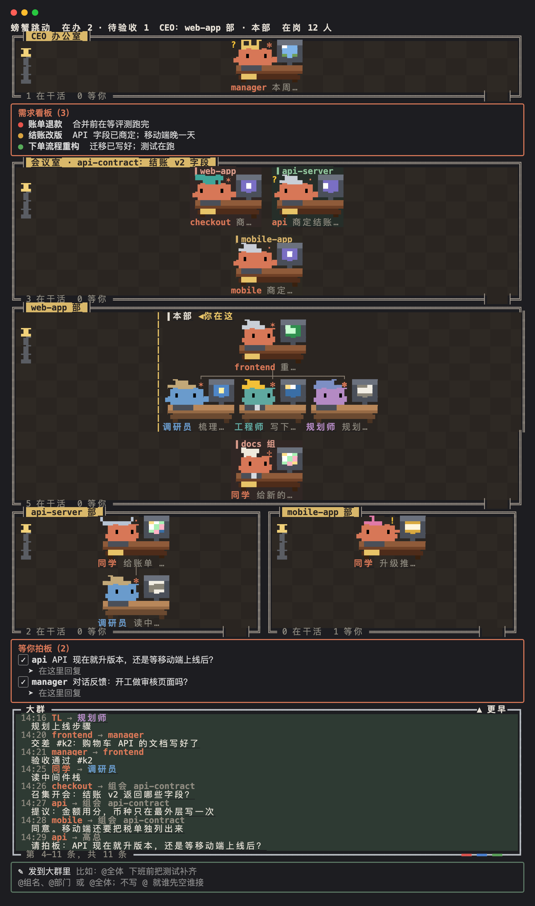

# 字节

*The office in Chinese, the way ByteDance colleagues talk. Switch it on with `/office theme 字节`.*

[← 所有主题](../README.md)

把办公室切成中文，按字节跳动同学的方式说话：同事之间叫"同学"，先说结论，不说空话；称呼你"X总"，X 由 CEO 来问你。



## 打开和关闭

```
/office theme 字节          # CEO 会在"等你拍板"里问你：「X总」的 X 填什么
/office theme 字节 高总      # 直接说怎么称呼你，就不再问
/office theme default       # 换回默认
```

## 改了哪些叫法

| 原来 | 字节主题里 |
| --- | --- |
| 董事长 | X总（还没答之前叫"老板"） |
| 螃蟹有限公司 | 螃蟹跳动 |
| 开会 / 会议 | 拉个组会 / 组会（会议室还叫会议室） |
| 共享白板 / 写在白板上 | 大群 / 发到大群里 |
| CEO 看板 | 需求看板 |
| 派活 / 交差 / 留言 | 派需求 / 交付 / 群消息 |
| 部长 / 组长 | TL / 同学 |

## 语气

字节主题给螃蟹们的语气说明：

> 同事之间直接叫名字或"同学"，不用"老师""某总"这类头衔；坦诚清晰，先说结论再补 context；常说"对齐一下""同步一下""拉个会""拉个群""对一下 OKR""+1""辛苦""收到"；不说"赋能""抓手""打造闭环"这种空话。

只改语气和称呼：汇报的内容照常平实（做完了 / 在做 / 要定的，一行一条）；代码、提交说明、PR、文档和产品文案一律不用这种语气。

## 听起来是什么样

下面改写自一次实际运行，只把名字和编号换掉了。

**两个同学对齐一件事**

> **feedback → mobile**：mobile 同学你好，手机端对话反馈有三件事想跟你对齐一下，结论先说：1. 放在哪：回复下面那排按钮里，挨着"复制""分享"。2. 谁来改：我来写，你来复核。3. 什么时候出第一版：要等改版那条 PR 合并以后。你回个 +1 或者改动意见就行，辛苦！
>
> **mobile → feedback**：feedback 同学，三件事都 +1。结论先说：位置和分工都按你说的；改版 PR 什么时候合我给不了日期。补充 context，有一处要对齐：那条 PR 并没有重写这排按钮，要等它是因为调用处要把对话 id 传进来。辛苦！
>
> **feedback → mobile**：收到，+1，辛苦！原因我写错了，谢谢纠正。
>
> **feedback → 高总**（发到大群）：高总，手机端反馈和 mobile 对齐完了，结论先说：位置定了，我写、mobile 复核；要等改版 PR 合并才能开工，排期得您来定。

**拉个组会**

> **召集人**：同学们好，拉个组会对齐一下合并顺序，10 分钟内收。先各自同步一下自己那条的状态和依赖，再请 mobile 同学汇总成一张顺序表。
>
> **mobile**：mobile 同步，先给结论：两个小 PR 已经能合，只差高总拍板；改版 PR 卡在作者那边；反馈排最后。顺序表草案先贴出来，大家改。
>
> **onboarding**：onboarding +1，我那一行没问题。补两点，都不改顺序。
>
> **feedback**：feedback +1。更正我前面说的一处：重叠的文件是两个，不是一个，以 mobile 查的为准。
>
> **召集人**（散会）：合并顺序对齐完了，三位同学都 +1。要高总拍板的有 4 件，单独列在下面。

口吻换了，内容没变虚：每一句都是结论在前，事实具体，说错了当场更正。

## 依据

语气按字节跳动公开说过的文化来写：

- 同事之间直接叫名字或"同学"，公司不提倡敬语和职称式称呼（[IT之家](https://www.ithome.com/0/808/756.htm)）。
- "Context, not Control"：弱化层级和头衔，内部不叫"老大""某总""老师"（[人人都是产品经理](https://www.woshipm.com/evaluating/3490887.html)）。
- 张一鸣批评过"赋能""打造闭环"这类说法是"不说人话"（[投资界](https://news.pedaily.cn/202104/469031.shtml)）。

只有对你的称呼是例外：你选了被叫"X总"。想更地道，可以用 `/office theme 字节 某某同学`。

## 文件

[`theme.json`](theme.json) 就是这个主题的全部内容。想改成自己的版本，把这个文件夹复制到 `~/.claude/crab-office/themes/` 下再改；名字相同时，用你的那份。
